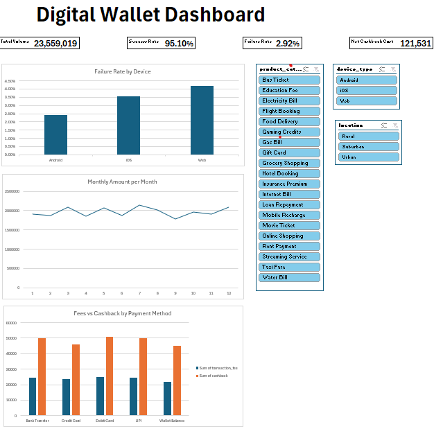

# Digital Wallet Transaction Analysis

Analysis of 5,000 digital wallet transactions to understand usage patterns, payment failures and the cost of cashback.

**Tools:** Python (Pandas, Matplotlib, Seaborn, SciPy) in Google Colab · Microsoft Excel (PivotTables, PivotCharts, slicers)

## Dataset
[Digital Wallet Transactions – Kaggle](https://www.kaggle.com/datasets/harunrai/digital-wallet-transactions)

- 5,000 transactions, Aug 2023 – Aug 2024
- Columns include product category, merchant, amount, fee, cashback, payment method, status, device and location

## Key Questions
1. What affects whether a transaction succeeds or fails?
2. Which merchants, devices and locations drive usage?
3. Does the cashback program cost more than the fees it earns?

## Process
1. **Data cleaning:** checked for missing values and duplicates (none), dropped the index column, converted dates.
2. **Feature engineering:** added month, weekday, hour, weekend flag, failure flag and cashback minus fee.
3. **Exploratory analysis:** compared the number of transactions and total amount across 9 features, split by status.
4. **Statistical testing:** correlation heatmap for numeric columns, Cramér's V for categorical columns, and a chi-square test for failure rate by device.
5. **Dashboard:** built an Excel dashboard with 4 KPI cards, 3 PivotCharts and slicers for category, device and location.

## Limitations
The dataset appears synthetic: values are evenly spread and uncorrelated. Findings describe this dataset only and should be validated with real transaction data.

## Files
| File | Description |
|---|---|
| `DigitalWalletPayment.ipynb` | Data cleaning, analysis and charts (Python) |
| `wallet_dashboard.xlsx` | Interactive Excel dashboard |
| `dashboard.png` | Dashboard screenshot |
